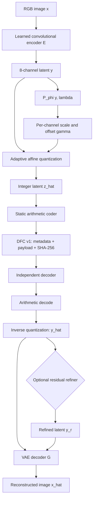
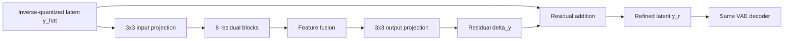
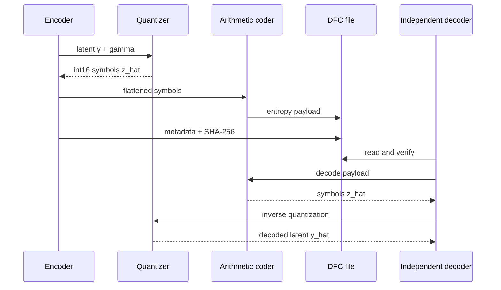

# LatentCompress

**A CPU-friendly learned latent image codec with adaptive quantization, arithmetic coding, and decoder-side latent refinement.**

Recommended GitHub description: `A CPU-friendly learned latent image codec with adaptive quantization, arithmetic coding, and decoder-side latent refinement.`

This project now uses a trained **Learned Convolutional Autoencoder (LC3)** plus **Lightweight Learned Latent Refinement**. New files use an 8-channel latent for more capacity; legacy 4-channel DFC files remain readable. It is not Stable Diffusion reconstruction and does not claim exact source-image recovery.

Train it on the supplied disjoint BSDS300 split:

```powershell
.\.venv\Scripts\python.exe scripts\train_refiner.py --train datasets\BSDS300-images\BSDS300\images\train --validation datasets\BSDS300-images\BSDS300\images\test --iterations 1000
```

The checkpoints are `models/autoencoder/best_model.pth` and `models/refiner/best_model.pth`; neither is inserted into a `.dfc` file. Decoder input remains the `.dfc` payload plus the shared local model files.

Retrain the convolutional codec when desired:

```powershell
.\.venv\Scripts\python.exe scripts\train_autoencoder.py --train datasets\BSDS300-images\BSDS300\images\train --validation datasets\BSDS300-images\BSDS300\images\test --iterations 2000
```

An interactive, research-oriented implementation scaffold for *Lossy Image Compression with Foundation Diffusion Models* (Relic et al.). It exposes an actual image → latent → adaptive quantization → arithmetic bitstream → independent `.dfc` decode → latent refinement → image path. It does **not** claim paper-result reproduction.

## Project summary

LatentCompress is a complete lossy image-compression pipeline: encode an image into a continuous latent, predict quantization parameters, quantize into integer symbols, arithmetic-code a checksummed `.dfc` file, decode independently without the source image, optionally refine the latent, and decode back to pixels. The decoder can use the `.dfc` payload and shared model checkpoints, but it cannot recover source pixels discarded by quantization.

## What currently works

- FastAPI image upload, MIME/size checks, jobs, polling/WebSocket endpoint, experiment SQLite store, and artifact downloads.
- A custom checksummed `.dfc` format containing latent shape, gamma, timestep, configuration, and a static arithmetic-coded latent payload.
- Actual quantization/inverse quantization and arithmetic encode/decode. Decoder requires only `.dfc`, never the source image.
- CPU-safe **Demo Mode**, explicitly labelled as a reduced neural codec plus a trained residual latent refiner—not Stable Diffusion and not paper-equivalent.
- **Research Mode** only uses Stable Diffusion v2.1 VAE/U-Net and fails clearly if its local dependencies/weights are unavailable. It will never silently fall back to demo models.
- React/Vite dashboard with VAE-baseline/refinement selection, job progress, actual computed metrics, latent/residual previews, reconstruction, and artifact downloads.

The supplied BSDS300 train/test split is used by the refiner training pipeline. It freezes the VAE and P_phi, feeds the real `quantize()` / `inverse_quantize()` output into the refiner at 0.10–0.40 target bpp, validates on the separate test split, checkpoints the best model, and records metrics. LPIPS is optional because its pretrained AlexNet metric weights must be installed separately; the application reports `n/a` rather than substituting a different metric.

For a requirement-by-requirement audit, see [implementation status](docs/implementation-status.md).

## Architecture

```mermaid
flowchart LR
  X[Input image] --> E[VAE encoder]
  E --> Y[8-channel latent y]
  Y --> P[P_phi: gamma, timestep]
  P --> Q[Adaptive quantization]
  Q --> Z[integer latent z_hat]
  Z --> C[Arithmetic coding / .dfc]
  C --> D[Independent .dfc decode]
  D --> IQ[Inverse quantization]
  IQ --> U[Lightweight learned latent refinement]
  U --> V[VAE decoder]
  V --> O[Reconstructed image]
```



### Component architecture



### Quantization method

For each latent channel, the predicted parameters are converted into an affine quantizer:

```text
scale  = (0.03 + softplus(gamma_scale)) * quantization_strength
offset = gamma_offset
u      = y / scale + offset
z_hat  = round(u), clamped to signed int16
y_hat  = (z_hat - offset) * scale
```

Lower requested bitrate widens the quantization bins. The `.dfc` metadata stores the latent shape, gamma values, quantization strength, model/mode, source dimensions, and refinement settings required for decoding.

### Refinement architecture

The refiner never sees the source image and does not generate pixels. It predicts only a latent correction: `delta_y = R_theta(y_hat)` and `y_r = y_hat + alpha * delta_y`.



### Training methodology

The refiner training runner freezes the autoencoder and `P_phi`, samples the six target rates `0.10–0.40` bpp, runs the real codec quantization path, and optimizes a weighted latent, pixel, and optional LPIPS loss. BSDS300 train and test directories remain separate. The best checkpoint is written to `models/refiner/best_model.pth`; its weights are shared decoder-side and are not inserted into a `.dfc` file.

## Comparison with diffusion models and the paper

The motivating paper, *Lossy Image Compression with Foundation Diffusion Models*, transmits a compressed latent and uses a foundation diffusion prior to generate plausible missing detail. A true diffusion reconstruction path uses a noise schedule, a denoising U-Net, timestep/conditioning embeddings, and multiple denoising steps.

| Concept | Paper / diffusion approach | LatentCompress Demo Mode |
|---|---|---|
| Image analysis | Frozen Stable Diffusion v2.1 VAE | Learned convolutional autoencoder; deterministic fallback exists |
| Entropy model | Paper-specific learned compression components | Static arithmetic coder + factorized logistic baseline |
| Decoder prior | Foundation diffusion prior with iterative denoising | One-pass latent residual CNN |
| Sampling | Multiple iterative denoising steps | No stochastic sampling in the default path |
| Detail recovery | Generative plausible detail | Codec-specific residual correction only |
| Scientific claim | Paper-level results require exact paper setup | Local baseline; no paper-result claim |

Compared with a plain convolutional autoencoder, this project adds explicit rate control, integer-symbol quantization, entropy coding, a portable file format, independent decoding, and an optional latent enhancement layer. It is a learned image codec with decoder-side refinement, not a diffusion sampler.



## Run locally

Requirements: Python 3.12+, Node 20+, and the packages in `requirements.txt`.

```powershell
python -m pip install -r requirements.txt
python -m uvicorn backend.main:app --reload --port 8000
```

In a second shell:

```powershell
cd frontend
npm install
npm run dev
```

Open `http://localhost:5173`. Backend docs are at `http://localhost:8000/docs`.

## Foundation-model setup

The default is safe/offline: `DIFFUSIONCOMPRESS_ALLOW_MODEL_DOWNLOAD=0`. For Research Mode, accept the `stabilityai/stable-diffusion-2-1-base` license on Hugging Face, create a user token with model-read access, set `HF_TOKEN`, and set `DIFFUSIONCOMPRESS_ALLOW_MODEL_DOWNLOAD=1`. The backend passes that token to Diffusers and reports a clear error if the gated model is unavailable. CUDA is selected automatically when PyTorch detects it. CPU Research Mode can be extremely slow.

For a small public integration smoke test only, set `DIFFUSIONCOMPRESS_MODEL_ID=diffusers/tiny-stable-diffusion-torch`. This checkpoint exercises real Diffusers VAE/U-Net calls but is not SD v2.1, is not paper-faithful, and must not be used for research claims. It has already been downloaded and successfully run through a 32×32 CPU encode/quantize/U-Net/decode smoke test in this workspace.

## `.dfc` v1

`magic(DFC1) | metadata JSON length | metadata JSON | static arithmetic-code payload | SHA-256`. Metadata records the model/mode, integer latent shape, gamma, steps, lambda, and source dimensions. The output has a checksum and fails on corruption. The entropy payload is not ZIP; an optional ZIP container has not been implemented.

## API

- `POST /api/compress`: multipart `image`, `mode`, `bitrate`, `lambda_value`, `steps`, `resolution`, `reconstruction_mode`, `refinement_alpha`; returns a job ID.
- `GET /api/jobs/{job_id}` and `WS /ws/pipeline/{job_id}`: progress/result.
- `POST /api/decompress`: upload a `.dfc`; returns reconstructed PNG.
- `GET /api/model/status`, `/api/system/status`, `/api/experiments`, `/api/metrics/{id}`.

Run checks with `pytest -q` and build the client with `cd frontend; npm run build`.

## Scientific limitations

At low rate, learned latent refinement can alter content. A difference/contribution map shows regions modified by reconstruction; it cannot prove exact recovery of discarded source information. Per-image FID is not meaningful and is not displayed. The supplied code therefore records every mode/model choice and documents deviations rather than presenting synthetic results.
